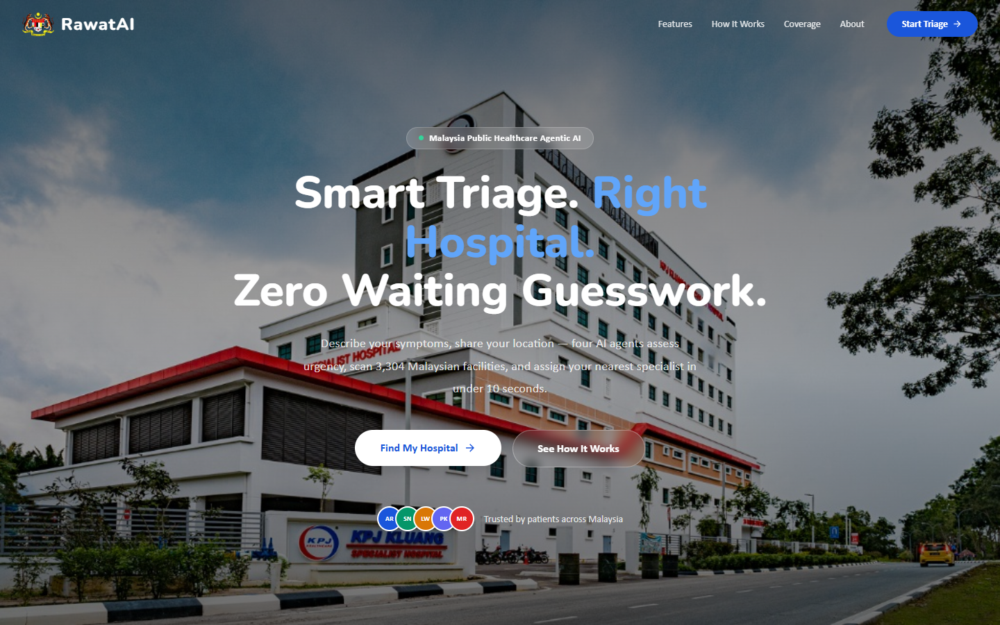
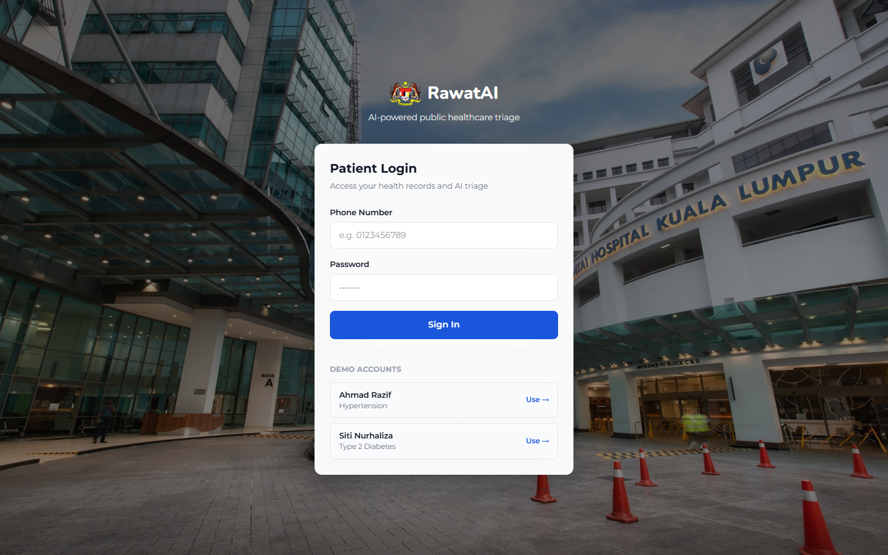
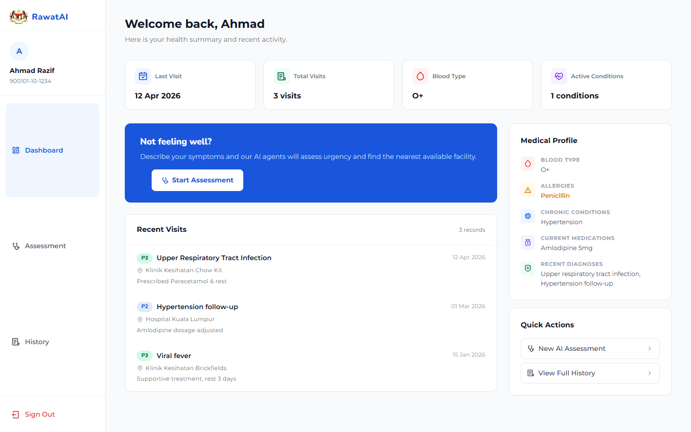
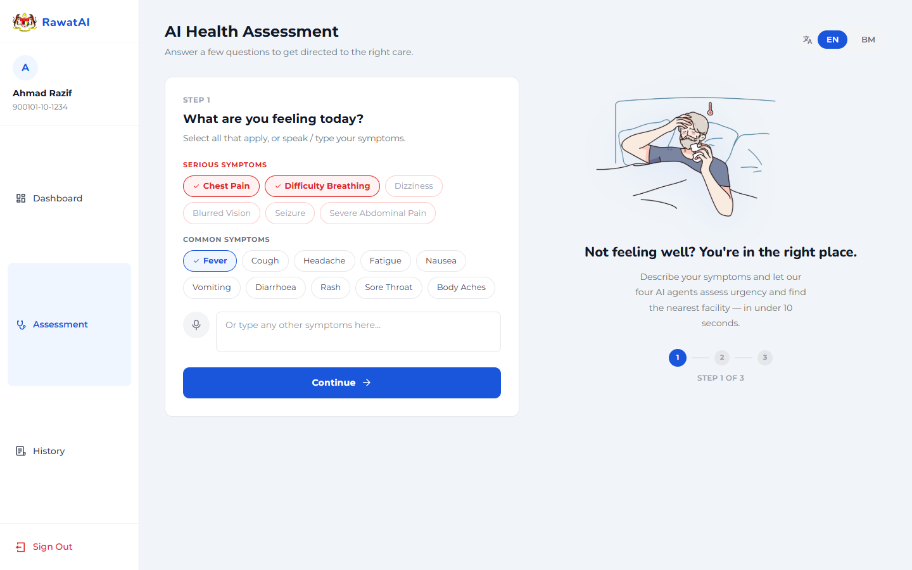
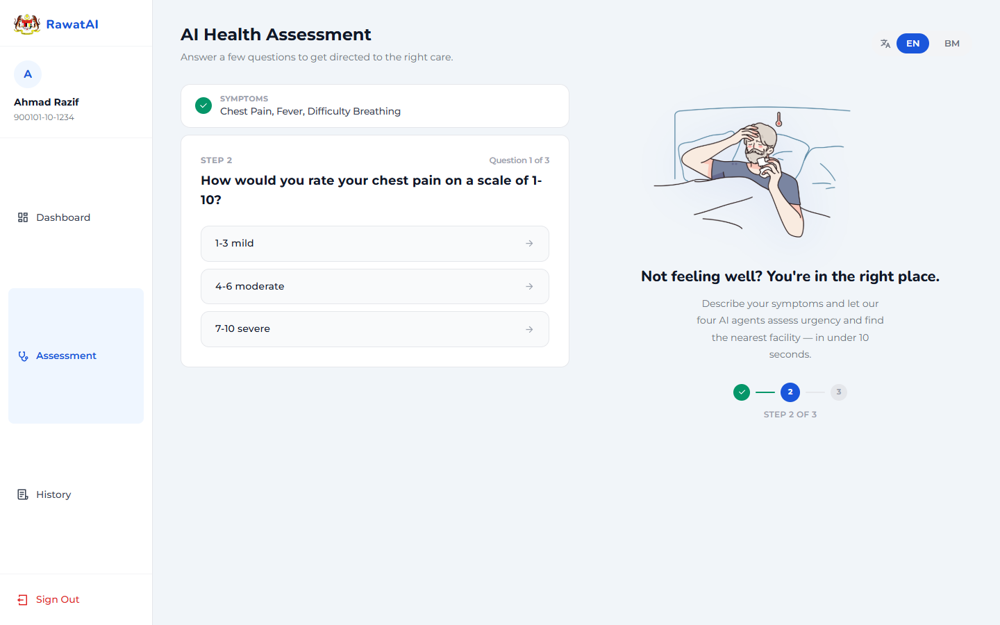
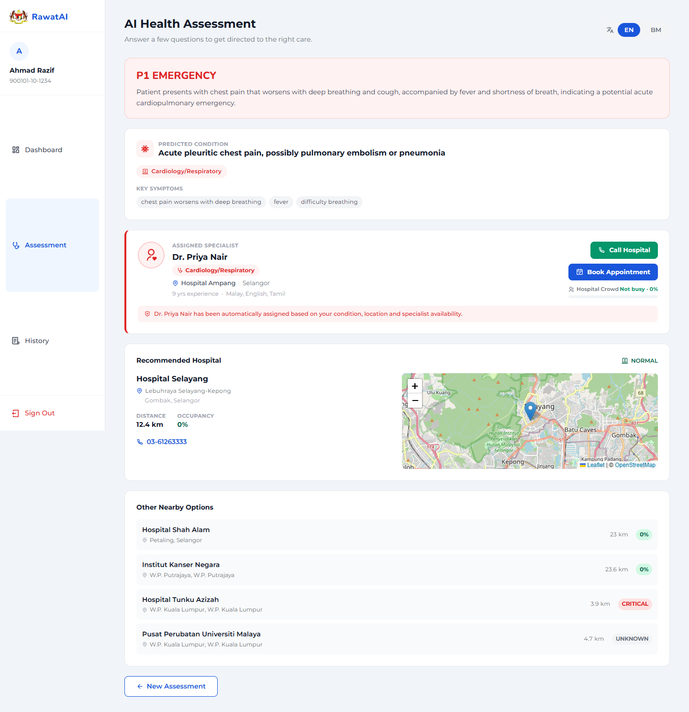
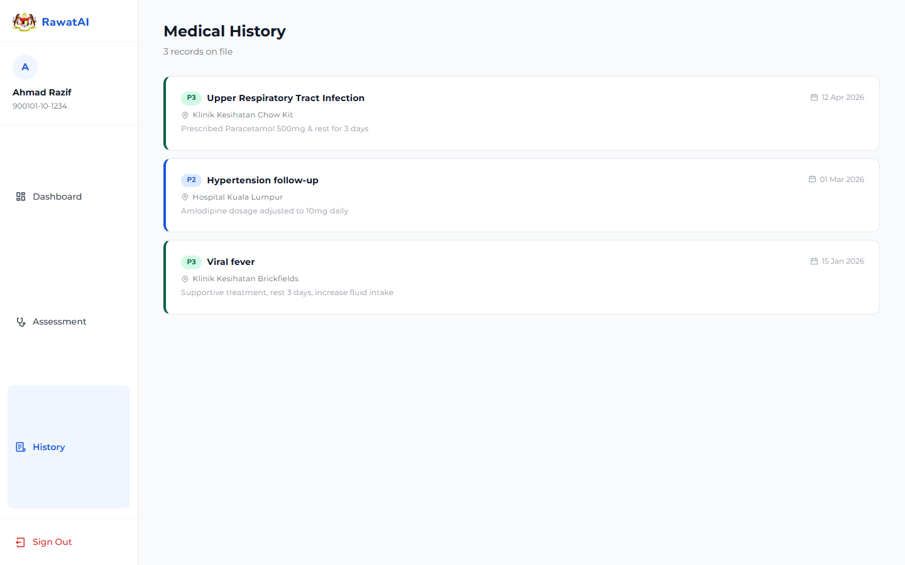

# RawatAI

AI patient triage and hospital routing for Malaysian public healthcare. Built for the Adaptive Malaysia Hackathon 2026.

A patient types or speaks their symptoms, optionally uploads a photo, and four AI agents work in sequence: they read the photo, classify urgency, find the best nearby facility and assign a specialist.

## Screenshots

Captured from a local run with the demo patient account.

**Landing page**



**Patient login**



**Patient dashboard**



**Step 1: choose or type symptoms**



**Step 2: AI follow-up questions**



**Result: priority, predicted condition, specialist, nearest hospital**



**Medical history**



## How it works

1. **Vision agent:** reads the uploaded photo (Groq vision model)
2. **Triage agent:** sets priority P1 (emergency), P2 (urgent) or P3 (non-urgent) and predicts the likely condition (Groq, gpt-oss-20b)
3. **Routing agent:** ranks nearby facilities by distance and bed utilisation, and reroutes if the top hospital is at critical capacity
4. **Assignment agent:** matches a specialist from a virtual pool of 16 doctors

Also: voice input, English and Bahasa Malaysia output, medical history used as triage context, and appointment booking with a live crowd bar.

## Running it locally

1. `npm install`
2. Create `.env.local` with a free key from https://console.groq.com:
   ```
   GROQ_API_KEY=
   ```
3. `npm run dev` and open http://localhost:3000

Demo patient logins (password `demo123`): phone `0123456789` (Ahmad Razif) or `0198765432` (Siti Nurhaliza).

## Data

Facility data comes from Ministry of Health Malaysia open data: 3,304 facilities with GPS and bed utilisation rates for 149 hospitals. The raw CSVs are in `datasets/`; the app reads the pre-processed `lib/facilities.json`.

## Tech stack

Next.js, React, TypeScript, Tailwind CSS v4, Groq API, Leaflet maps. There is no database: cases are kept in memory, so they reset when the server restarts.

## Layout

- `app/api`: triage, vision, routing, assign and notify routes
- `app/patient`: dashboard, triage and history pages
- `lib`: routing logic, doctor pool, locations, in-memory store
- `components`: navigation and facility map
