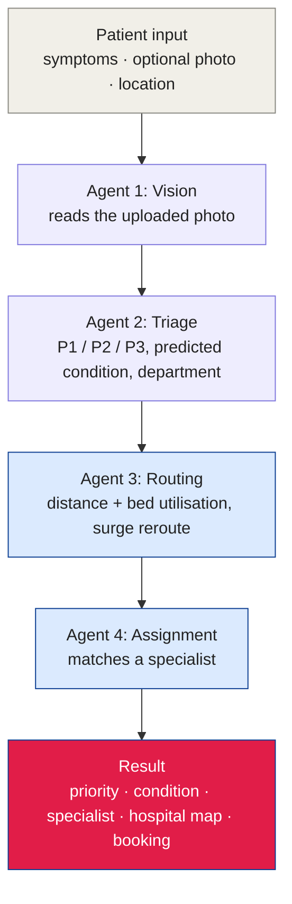

<div align="center">


<a href="#screenshots"></a>

<br/>

[](https://nextjs.org)
[](https://react.dev)
[](https://www.typescriptlang.org)
[](https://tailwindcss.com)
<br/>
[](https://groq.com)
[](https://leafletjs.com)
[](#project-overview)

</div>

---

##  Project Overview

RawatAI is an AI patient triage and hospital routing system for Malaysian public healthcare, built for the **Adaptive Malaysia Hackathon 2026**. A patient types or speaks their symptoms, optionally uploads a photo, and a pipeline of four AI agents works out how urgent the case is, what it might be, where to go and who to see, with no human in the loop.

### Key Features

-  **Urgency triage**: every case is classed P1 (emergency), P2 (urgent) or P3 (non-urgent), with the reasoning shown.
-  **Condition prediction**: the likely condition, the matching department and the key symptoms.
-  **Nearest suitable facility**: ranks 3,304 Ministry of Health facilities by distance and bed utilisation, and reroutes if the top hospital is at critical capacity.
-  **Specialist assignment**: matches a doctor from a virtual pool of 16 across 9 specialties, with one-tap call and appointment booking.
-  **Voice and language**: speak symptoms with the Web Speech API, and switch the whole flow between English and Bahasa Malaysia.
-  **Medical history as context**: chronic conditions and medications are fed into the triage prompt.

##  Screenshots

All screenshots are from a local run with the demo patient account.

**Landing page**


**Patient dashboard**


**Step 1: choose or type symptoms**


**Step 2: AI follow-up questions**


**Result: priority, predicted condition, specialist and nearest hospital**


**Medical history**


##  Requirements

- Node.js 20 or newer
- A free [Groq API key](https://console.groq.com)

##  Quick Start

```bash
git clone https://github.com/mukesh-dev-git/RawatAI.git
cd RawatAI
npm install

# Add your Groq key
echo "GROQ_API_KEY=your_key_here" > .env.local

npm run dev
```

Open http://localhost:3000 and sign in with a demo patient (password `demo123`):

| Name | Phone | Conditions |
|---|---|---|
| Ahmad Razif | `0123456789` | Hypertension |
| Siti Nurhaliza | `0198765432` | Type 2 diabetes |

##  How It Works



Triage rules add safeguards on top of the model, for example fever for more than two days is at least P2, and hypertension or diabetes with fever is at least P2.

##  Data

Facility data comes from Ministry of Health Malaysia open data: 3,304 facilities with GPS coordinates, plus bed utilisation rates for 149 hospitals. The raw CSVs are in `datasets/`, and the app reads the pre-processed `lib/facilities.json`. A few source rows have impossible utilisation values (negative or above 100%), and routing treats those as unknown.

##  Project Structure

```
RawatAI/
├── app/
│   ├── page.tsx               # landing page
│   ├── login/
│   ├── patient/               # dashboard, triage, history
│   └── api/                   # questions, triage, vision, routing, assign, notify
├── lib/
│   ├── routing.ts             # haversine distance and facility scoring
│   ├── doctors.ts             # virtual specialist pool
│   ├── locations.ts           # 29 Malaysian cities
│   └── facilities.json        # processed MoH data
├── components/                # navigation, facility map
├── datasets/                  # source CSVs
└── docs/screenshots/
```

There is no database: cases are held in memory and reset when the server restarts.

##  Acknowledgments

- Ministry of Health Malaysia for the open facility and bed utilisation data
- The Adaptive Malaysia Hackathon 2026 organisers
- Built with Next.js, Groq and Leaflet

<div align="center">


</div>
